<div align="center">

# Patti Royale · Rewards

**An in-game commerce store where you earn the coins you spend.**

A playable, genuinely losable card match, a reward store built around it, and a live PM console
that instruments every tap. Built as a product assignment for PlaySuper.

> *In e-commerce, the cart is dead intent. In a game, the cart is a retention loop.*

[](https://github.com/DaenerysDrag/patti-royale-playsuper/actions/workflows/deploy.yml)


### [▶ Play it live](https://daenerysdrag.github.io/patti-royale-playsuper/) · [📄 Product note](SUBMISSION.md) · [🧠 Reasoning docs](docs/)

<br/>

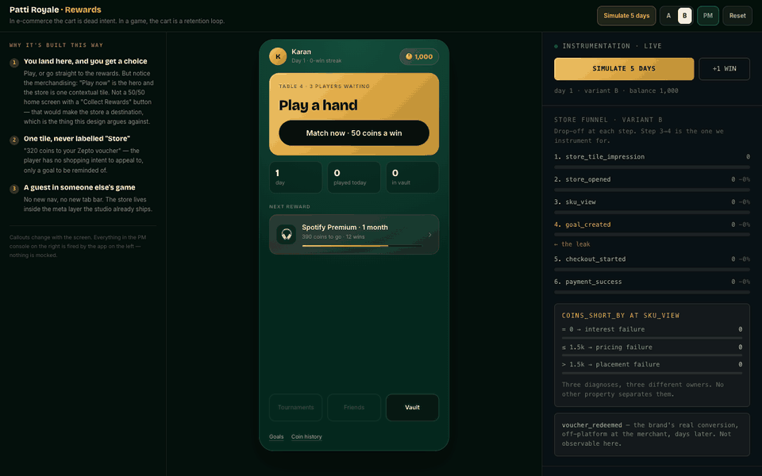

<sub>A real run on the live site: win a match → claim a voucher → reserve a bigger reward → simulate 5 days of play → claim it with coins + cash. The funnel on the right is fired by the clicks on the left. Nothing is mocked.</sub>

</div>

---

## The problem

PlaySuper's model is simple: **coins cover the discount, the rest is cash.** The hard part is that
a player opening a mobile card game has **no purchase intent at all**. They have about 40 seconds
between matches, and they assume in-game "free rewards" are a scam.

A store that behaves like a shop (browse, add to cart, check out) fails here, because nobody
came to shop. So I didn't build a storefront. I built a **coin sink that turns accumulated play
into a reason to play again**, without touching in-app purchases.

<p align="center">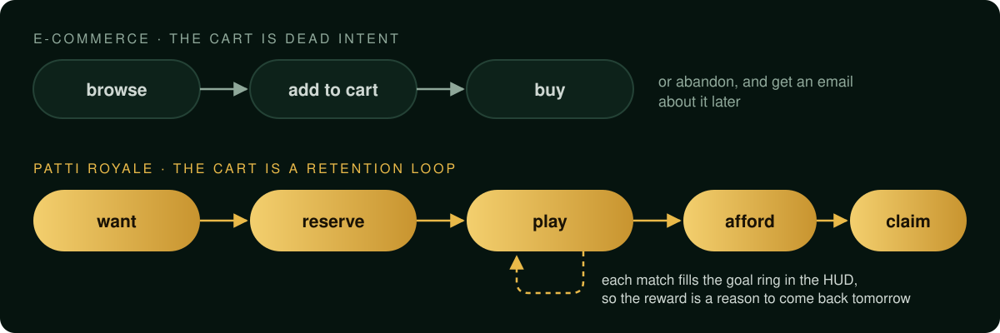</p>

**Goals are the invention.** Reserve a reward you can't afford yet and it becomes a ring in the
match HUD. Every match fills it. The funnel inverts from `browse → buy` to
`want → play → afford → buy`, and it's the one part of the design that plausibly moves D7
retention.

---

## Tour

<table>
<tr>
<td align="center" width="25%">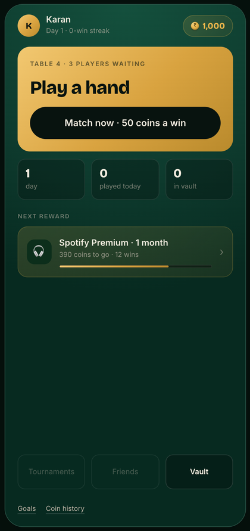<br/><b>Lobby</b><br/><sub>The store is one contextual tile, never labelled "Store"</sub></td>
<td align="center" width="25%">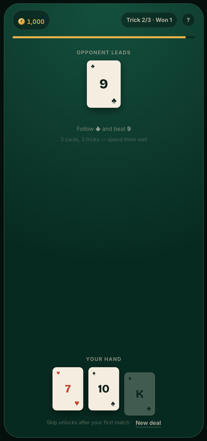<br/><b>The match</b><br/><sub>Follow suit and beat it. Spend your high card on the wrong trick and you lose</sub></td>
<td align="center" width="25%">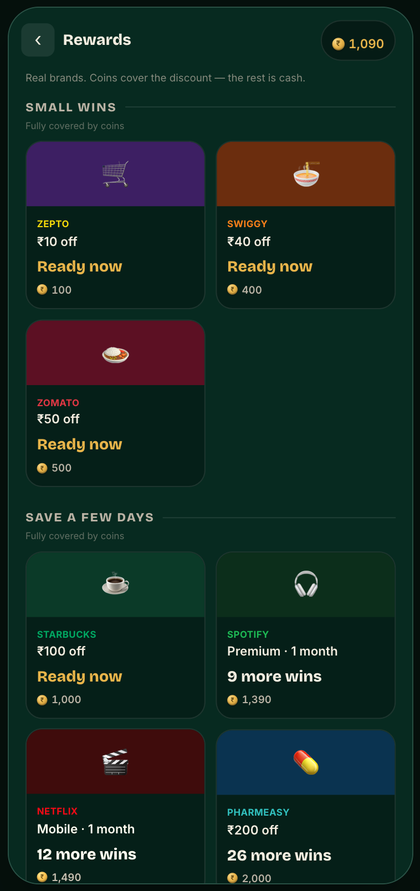<br/><b>Rewards</b><br/><sub>12 items, 3 fixed groups, priced in effort: "9 more wins"</sub></td>
<td align="center" width="25%">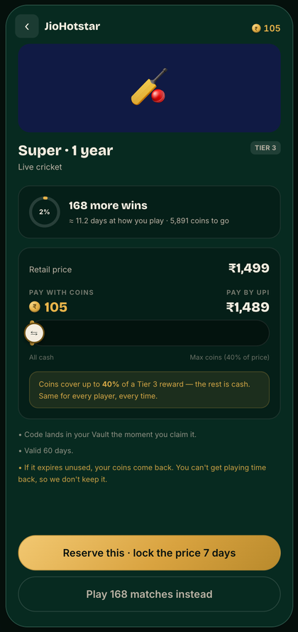<br/><b>Can't afford it?</b><br/><sub>The button becomes "reserve". Never a dead end</sub></td>
</tr>
<tr>
<td align="center">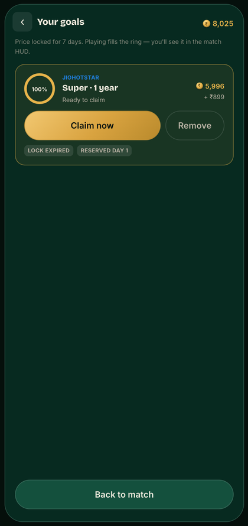<br/><b>Goals</b><br/><sub>Price locked for 7 days. Playing fills the ring</sub></td>
<td align="center">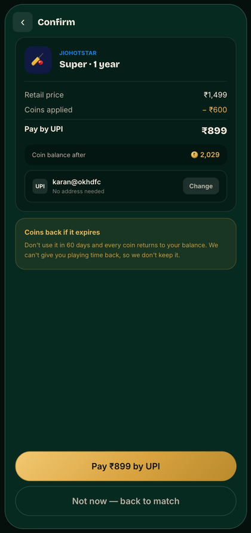<br/><b>Coins + cash</b><br/><sub>Coins cover the discount, UPI pays the rest. No address form</sub></td>
<td align="center">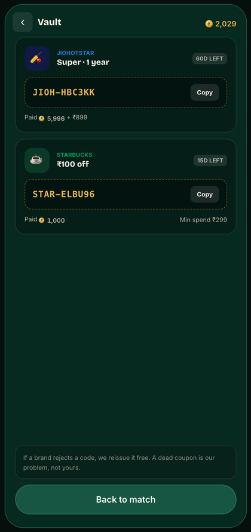<br/><b>Vault</b><br/><sub>Codes you own. Reissued free if a brand rejects one</sub></td>
<td align="center">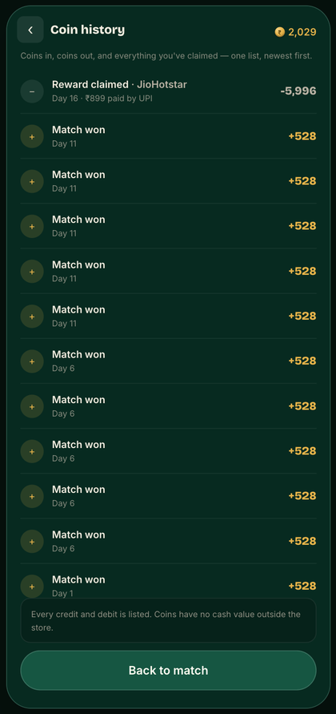<br/><b>Coin history</b><br/><sub>One ledger. The balance always equals the sum of its lines</sub></td>
</tr>
</table>

### The PM console

On a laptop, the phone sits between two rails. The **left rail** explains why each screen is
built the way it is, and it changes with the screen. The **right rail** is a live PM console: the
store funnel with the leak named, a diagnosis of *why* players drop, a live A/B switch, and the
raw event stream.

<p align="center">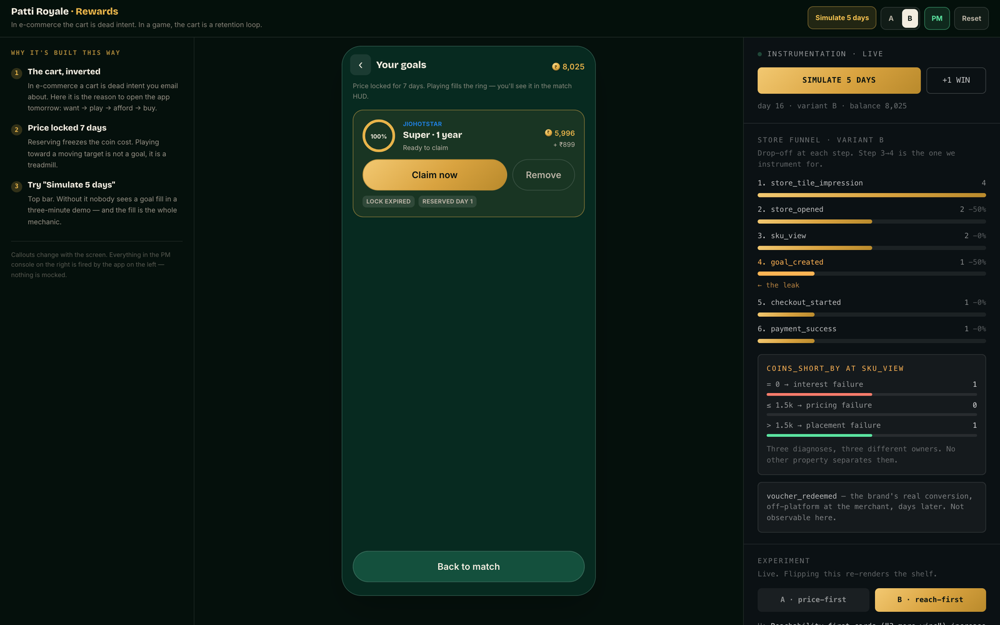</p>

The key number is **`coins_short_by`**, logged when a player views an item. It's the one property
that tells three different failures apart, each with a different owner:

| `coins_short_by` at `sku_view` | Diagnosis | Who fixes it |
|---|---|---|
| **= 0** and they still don't reserve | interest failure | catalog / merchandising |
| **≤ 1,500** coins short | pricing failure | economy design |
| **> 1,500** coins short | placement failure | shelf order and tiering |

`voucher_redeemed` is greyed out in the console as *not observable here*: the brand's real
conversion happens off-platform, days later. One fake number would discredit the whole panel, so
I didn't fake it.

---

## Product decisions

| Decision | Why |
|---|---|
| **The match is losable** | Win 50 coins, lose 15. Only two of the opponent's three leads are beatable, so the skill is *allocation*. If the match couldn't be lost, coins would be granted rather than earned, and every "3 more wins" on the shelf would be decoration. |
| **No search, no filters** | 12 items in 3 fixed groups. The attention window is about 40 seconds. |
| **Effort pricing** | "3 more wins" sits next to "₹389". Effort is the honest price of a coin. |
| **Zero dead ends** | Every unaffordable item offers a path: reserve it, or play for it. Never a wall. |
| **Goals ≠ Vault** | Goals are reserved and unpaid. The Vault holds codes you own. Mixing them breaks trust. |
| **Coins back on expiry** | If a code expires unused, every coin returns. You can't refund someone's time, so we don't keep it. |
| **The coin cap belongs to the item** | Small rewards are 100% coin-payable, premium ones 40%. No loyalty tiers, no personalised pricing, and the shelf order is the same for everyone. |
| **A guest in someone else's game** | No new navigation, no new tab bar. The store lives inside the meta layer the studio already ships. |

## The economics behind it

**The brand funds the discount as customer-acquisition cost, not the studio.** So the binding
constraint isn't coin supply, it's **brand CAC budget and coupon inventory**. Coins can be
generous. What has to be rationed is *conversion*, which is why there's a redemption cap and no
paywall on earning.

Back-solving PlaySuper's published **+5.2% ARPDAU** lift (₹0.80 baseline, ₹700 average order,
10% commission, 50% studio share) gives an implied **0.119% of DAU redeeming per day**: about 1
player in 840. So the thing to optimise is **retention breadth, not conversion depth**.

> **North Star:** % of DAU holding an active goal.
> **Guardrails:** IAP ARPDAU flat or up · session length flat or up · redemption cap honoured · coins never buy in-game power.

The full derivation is in [`docs/02-economy.md`](docs/02-economy.md) and the
[product note](SUBMISSION.md).

---

## Try it in 60 seconds

You start with **1,000 coins**, so nothing needs grinding.

1. **Match now → Deal my cards.** Three tricks, three cards: follow suit and beat it. Try losing
   one on purpose. A loss still pays, and the game never scolds you.
2. **Rewards → Starbucks ₹100.** Two taps, no cart, and the code goes straight into the Vault.
3. **Rewards → JioHotstar Super.** You can't afford it, so the button becomes *Reserve*. A ring
   appears in the match HUD. **This is the product.**
4. **Simulate 5 days** (top bar) until the goal completes, then **claim it**: coins cover the
   discount and UPI pays the rest.
5. Watch the **PM console** the whole time. **Reset** (top bar) wipes everything for the next
   person.

---

## Engineering

The interesting part is the guardrails. The type system and runtime checks stop the product rules
from drifting:

- **Event names are a closed union.** `EventName` in [`events.ts`](app/src/events.ts) is a
  TypeScript union taken from the [event taxonomy](docs/03-event-taxonomy.md), so an invented
  event name is a compile error, not a silent gap in the funnel.
- **The wallet is a ledger, not a number.** `wallet === sum(ledger.delta)` is asserted in
  development. Even the demo's starting coins arrive through a `demo_credit` ledger line instead of
  being written straight to the balance.
- **One source of truth for the economy.** Every rate, peg, cap and threshold lives in
  [`constants.ts`](app/src/constants.ts) and nowhere else, mirrored in prose in
  [`docs/02-economy.md`](docs/02-economy.md).
- **One layout at every size.** The phone is a fixed 390×844 canvas scaled with
  `transform: scale()`, so the design never reflows into a different product on another screen.
- **Pointer events everywhere.** The coin slider works with a finger, a mouse and the arrow keys.
- **CI on every push.** GitHub Actions typechecks, builds and republishes to Pages.

**Stack:** React 19 · TypeScript · Vite · Tailwind CSS 4 · Framer Motion · Zustand (persisted to
`localStorage`). No backend, no keys, no accounts. About 2,700 lines across 10 screens.

### How I worked with AI

I built this with **Claude Code** and kept the product decisions mine:

- I wrote a **7-phase gated brief** and made the model stop at checkpoints for review instead of
  generating everything in one pass.
- [`CLAUDE.md`](CLAUDE.md) holds **10 standing rules** the model had to follow, for example "never
  fabricate a number the system cannot observe" and "no dead ends".
- Twice the model flagged that **my own numbers broke the design**. The first earn rate made a
  "this month" reward affordable in five days, and one set of price bands couldn't be "reach
  today" for both a daily grinder and a weekly dipper. Both flags changed the design, and the note
  says so.
- I also ran a parallel visual pass in **Claude Design** and ported only what fit: the type scale,
  button geometry and the console layout. I rejected its palette and its economy panel, because
  that panel's own footer said the figures were illustrative, not instrumented.

---

## Run it locally

```bash
cd app
npm install
npm run dev          # http://localhost:5173
npm run typecheck    # tsc -p tsconfig.app.json --noEmit
npm run build
```

Node 20+. State persists to `localStorage`.

> `npm run typecheck`, not a bare `tsc --noEmit`. In a Vite project with project references, the
> root tsconfig has `"files": []`, so a bare `tsc --noEmit` checks nothing and still exits 0.

## Layout

```
SUBMISSION.md        the product note: thesis, assumptions, decisions, economics, open questions
docs/                assumptions · economy · event taxonomy · build spec · integrity & abuse
app/src/
  constants.ts       every economy number, and nowhere else
  catalog.ts         12 digital rewards across 3 tiers
  pricing.ts         coin cost, cash due, effort copy ("3 more wins")
  events.ts          the event bus; EventName is a closed union
  store.ts           Zustand + localStorage; the wallet/ledger invariant
  screens/           Lobby · Match · Reward · Shelf · Product · Checkout · Confirm · Goals · Vault · Ledger
  components/        PmPanel (funnel · experiment · event stream), CoinSlider, HowToPlay
  annotations.ts     the per-screen design callouts on the left rail
```

---

<div align="center">

Built by **Karan Makol** · [@DaenerysDrag](https://github.com/DaenerysDrag) · karan.makol1@gmail.com

</div>
